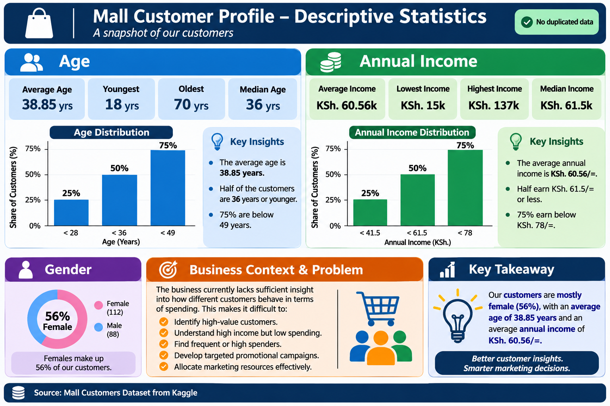

# Introduction to Descriptive Statistics


<!-- Update the path above to where the infographic lives in this repo -->

## What are descriptive statistics?

Descriptive statistics are numbers and charts that **summarise a dataset** so we can understand it at a glance. They describe the data we *have*; they do not make predictions or draw conclusions about a larger population (that is inferential statistics).

Before cleaning, modelling or building any machine learning model, a data scientist first asks two questions:

1. **Where is the centre?** What is a typical value? → *Measures of Central Tendency (MCTs)*
2. **How spread out is it?** How much do values differ from that typical value? → *Measures of Variation (MoVs)*

You need both. Two datasets can have the same average and still look completely different.

## Measures of Central Tendency (MCTs)

| Measure | What it is | Watch out for |
|---|---|---|
| **Mean** | Sum of values ÷ number of values | Pulled by outliers |
| **Median** | Middle value after sorting | Ignores the size of extreme values (usually a good thing) |
| **Mode** | Most frequent value | Can have none, one, or several modes |

**Quick example:** monthly salaries (KES '000) of 30, 35, 40, 45, 500
- Mean = 130k, which describes nobody on the team
- Median = 40k, which describes a typical team member

**Rule of thumb:** use the **mean** for symmetric data, the **median** for skewed data or data with outliers, and the **mode** for categories.

## Measures of Variation (MoVs)

| Measure | What it is | Use when |
|---|---|---|
| **Range** | Max − Min | You want a quick, rough check |
| **Variance** | Average squared distance from the mean | Doing further statistics or modelling |
| **Standard deviation (SD)** | Square root of the variance; same units as the data | Data is roughly symmetric |
| **Interquartile range (IQR)** | Q3 − Q1, the spread of the middle 50% | Data is skewed or has outliers |
| **Coefficient of variation (CV)** | SD ÷ Mean × 100% | Comparing spread across different units or scales |

**Pairing rule:** report the **mean with the SD**, and the **median with the IQR**.

## The shape of the data (distribution)

A **distribution plot** (histogram or density curve) shows how often each value occurs.

- **Symmetric:** mean ≈ median
- **Right-skewed** (long tail to the right): mean > median, e.g. income
- **Left-skewed** (long tail to the left): mean < median

You do **not** need to sort the data before plotting a histogram or density curve; the plotting library groups the values into bins for you.

## Quick start in Python

```python
import pandas as pd
import seaborn as sns
import matplotlib.pyplot as plt

s = pd.Series([4, 8, 6, 5, 3, 8, 9])

print(s.describe())                 # count, mean, std, min, quartiles, max
print("Median:", s.median())
print("Mode:", s.mode().tolist())
print("IQR:", s.quantile(0.75) - s.quantile(0.25))

sns.histplot(s, kde=True)
plt.axvline(s.mean(), color="red", linestyle="--", label="Mean")
plt.axvline(s.median(), color="green", label="Median")
plt.legend()
plt.show()
```

> **Note:** pandas `.std()` and `.var()` use the **sample** formula (divide by n − 1) by default, while NumPy's `np.std()` uses the **population** formula (divide by n). Always state which one you used.

## Key takeaways

- Always describe the data before modelling it.
- The centre alone is never enough; report the spread too.
- Outliers and skew change which measures you should trust.
- Plot the data; a chart often reveals what a single number hides.