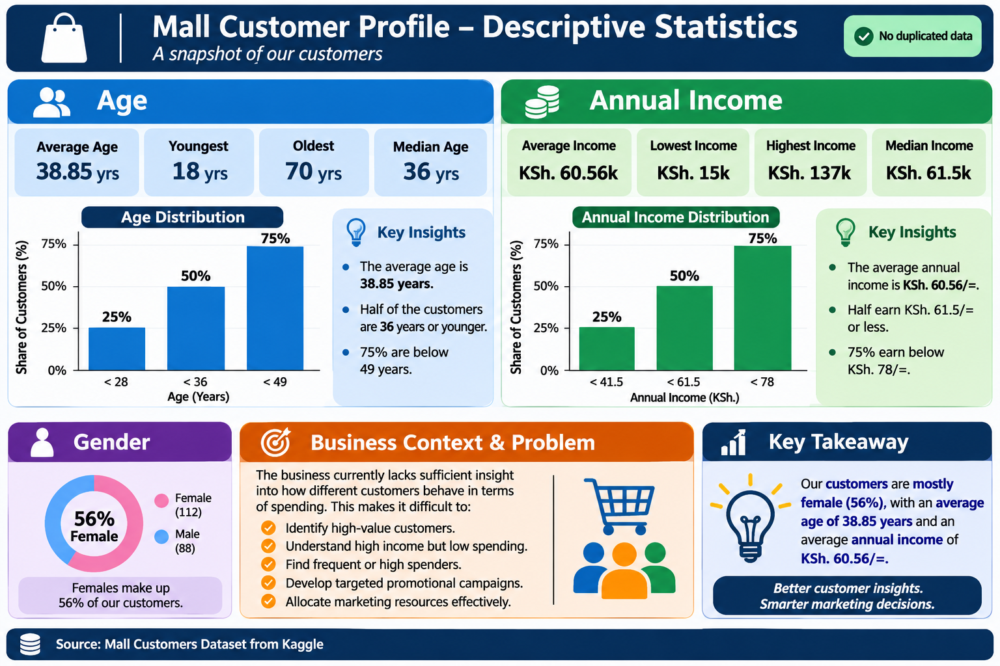

# Introduction to Descriptive Statistics


<!-- Update the path above to where the infographic lives in this repo -->

## What are descriptive statistics?

Descriptive statistics are numbers and charts that **summarise a dataset** so we can understand it at a glance. They describe the data we *have*; they do not make predictions or draw conclusions about a larger population (that is inferential statistics).

Before cleaning, modelling or building any machine learning model, a data scientist first asks two questions:

1. **Where is the centre?** What single number best represents all the data? → *Measures of Central Tendency (MCTs)*
2. **How spread out is it?** How far are the data points from that centre? → *Measures of Variation (MoVs)*

You need both. Two datasets can have the same average and still look completely different:
 


## Measures of Central Tendency (MCTs)

| Measure | What it is | Watch out for |
|---|---|---|
| **Mean** | Sum of values ÷ number of values | Pulled by outliers |
| **Median** | Middle value after sorting | Ignores the size of extreme values (usually a good thing) |
| **Mode** | Most frequent value | Can have none, one, or several modes |

**Quick example:** monthly salaries (KES '000) of 30, 35, 40, 45, 500
- Mean = 130k, which describes nobody on the team
- Median = 40k, which describes a typical team member

**Rule of thumb:** use the **mean** for symmetric data, the **median** for skewed data or data with outliers, and the **mode** for categories.

## Measures of Variation (MoVs)

Once we have a centre, measures of variation tell us how far the data points spread out from it.

| Measure | What it is | Use when |
|---|---|---|
| **Range** | Max − Min | You want a quick, rough check |
| **Quartiles / percentiles** | Values that split sorted data into parts (e.g. 25%, 50%, 75%) | You want to know where the data sits |
| **Interquartile range (IQR)** | Q3 − Q1, the spread of the middle 50% | Data is skewed or has outliers |
| **Variance** | Average squared distance from the mean | Doing further statistics or modelling |
| **Standard deviation (SD)** | Square root of the variance; same units as the data | Data is roughly symmetric |
| **Coefficient of variation (CV)** | SD ÷ Mean × 100% | Comparing spread across different units or scales |

**Pairing rule:** report the **mean with the SD**, and the **median with the IQR**.

We use one small dataset for the hand calculations below:

```
1, 2, 3, 4, 5, 6, 7        mean x̄ = 28 / 7 = 4
```

### Range

**Range = max − min** tells you how big the gap is between the smallest and largest value.

For 1, 2, 3, 4, 5, 6, 7: range = 7 − 1 = **6**.

It is quick, but it only uses two values, so a single outlier can change it completely.

### Quartiles and percentiles

Sort the data and cut it into four equal parts. The three cut points are the **quartiles**:

| Quartile | Percentile | Meaning |
|---|---|---|
| **Q1** (lower quartile) | 25th | 25% of the data is below this value |
| **Q2** (median) | 50th | 50% of the data is below this value |
| **Q3** (upper quartile) | 75th | 75% of the data is below this value |

A **percentile** works the same way for any percentage: the 90th percentile is the value that 90% of the data falls below.

### Interquartile range (IQR)

**IQR = Q3 − Q1**, the width of the middle 50% of the data. Because it ignores the lowest 25% and highest 25%, outliers barely affect it.

**Example: Mall Customers dataset, `Age` column** (from `df.describe()`):

| Statistic | Value |
|---|---|
| count | 200 |
| mean | 38.85 |
| std | 13.97 |
| min | 18 |
| 25% (Q1) | 28.75 |
| 50% (Q2, median) | 36 |
| 75% (Q3) | 49 |
| max | 70 |

Reading it:
- 25% of customers are younger than **28.75** years
- 50% are younger than **36** (the median)
- 75% are younger than **49**
- **IQR = 49 − 28.75 = 20.25**, so the middle half of customers are aged between about 29 and 49, a span of roughly 20 years.

> **Common mistake:** an IQR of 20 does **not** mean most customers are about 20 years old. It is the *width* of the range where the middle 50% sit, not an age.

### Box plots and outliers

A box plot is a picture of the quartiles:


- The **box** runs from Q1 to Q3, so its length is the IQR
- The **line inside the box** is the median (Q2)
- The **whiskers** reach the furthest points that are not outliers
- Points beyond the **fences** are flagged as **outliers**:
  - lower fence = Q1 − 1.5 × IQR
  - upper fence = Q3 + 1.5 × IQR

For Mall Customers `Age`: upper fence = 49 + 1.5 × 20.25 = 79.4 and lower fence = 28.75 − 30.4 = −1.6. Ages run from 18 to 70, so **there are no outliers in Age**.

**Example: house prices (Housing dataset)**


- Most prices sit inside the box and whiskers. A few very expensive houses appear as outlier points on the right.
- Mode (3.5M) < Median (4.34M) < Mean (4.77M), so the data is **right-skewed**. The expensive houses pull the mean up.
- Here the **median and IQR** describe a typical house better than the mean and SD.

> **Outliers are not automatically "bad data".** Those houses are real and really are expensive. An outlier is a value worth checking: it might be a data-entry error (remove or fix it), or it might be genuine (keep it, and use robust measures such as the median and IQR).

### Variance

Each value's **deviation** is its distance from the mean, x − x̄. Values below the mean have negative deviations and values above it have positive ones.


The deviations always add up to zero, so their average is useless. Instead we **square** them, which makes them all positive, and then average:

| x | x − x̄ | (x − x̄)² |
|---|---|---|
| 1 | −3 | 9 |
| 2 | −2 | 4 |
| 3 | −1 | 1 |
| 4 | 0 | 0 |
| 5 | 1 | 1 |
| 6 | 2 | 4 |
| 7 | 3 | 9 |
| **Σ = 28** | **Σ = 0** | **Σ = 28** |

| | Formula | For 1–7 |
|---|---|---|
| **Population variance** | σ² = Σ(x − μ)² ÷ N | 28 ÷ 7 = **4** |
| **Sample variance** | s² = Σ(x − x̄)² ÷ (n − 1) | 28 ÷ 6 ≈ **4.67** |

**Why n − 1 for a sample?** A sample's values sit closer to their own mean than to the true population mean, so the squared deviations come out slightly too small. Dividing by n − 1 (Bessel's correction) corrects for this. In practice your data is almost always a sample.

The catch: variance is in **squared units** (years², KES²), which is hard to interpret. Standard deviation fixes that.

### Standard deviation (SD)

**SD = √variance**, back in the data's original units. Read it as the typical distance of a value from the mean.

For 1–7: sample SD = √4.67 ≈ **2.16** (population SD = √4 = 2).

For Mall Customers `Age`: SD ≈ 13.97, so a typical customer is about 14 years away from the mean age of 38.85.

**The empirical (68–95–99.7) rule.** For roughly bell-shaped (normal) data:


- about **68%** of values fall within 1 SD of the mean
- about **95%** fall within 2 SD
- about **99.7%** fall within 3 SD

This does **not** hold for skewed data such as house prices or income.

### Coefficient of variation (CV)

**CV = SD ÷ Mean × 100%** expresses spread as a percentage of the mean, so you can compare columns measured in different units.

Mall Customers:

| Column | Mean | SD | CV |
|---|---|---|---|
| Age (years) | 38.85 | 13.97 | 36% |
| Annual Income (k$) | 60.56 | 26.26 | 43% |
| Spending Score (1–100) | 50.20 | 25.82 | 51% |

Spending Score varies the most relative to its average.

> `describe()` also gives a mean and SD for **CustomerID**, but these are meaningless because IDs are labels, not quantities. Always ask whether a number column is really a measurement before summarising it.

Only use CV for data with a true zero and a positive mean (not temperature in °C, not profit/loss).

## The shape of the data (distribution)

A **distribution plot** (histogram or density curve) shows how often each value occurs.

- **Symmetric:** mean ≈ median
- **Right-skewed** (long tail to the right): mode < median < mean, e.g. income and house prices
- **Left-skewed** (long tail to the left): mean < median < mode

Plotting a box plot above a histogram (as in the house-price chart) shows the centre, the spread, the shape and the outliers in one picture.

You do **not** need to sort the data before plotting a histogram or density curve; the plotting library groups the values into bins for you.

## Quick start in Python

```python
import pandas as pd
import seaborn as sns
import matplotlib.pyplot as plt

s = pd.Series([1, 2, 3, 4, 5, 6, 7])

print(s.describe())                 # count, mean, std, min, quartiles, max
print("Median:", s.median())
print("Mode:", s.mode().tolist())
print("Range:", s.max() - s.min())
q1, q3 = s.quantile([0.25, 0.75])
print("IQR:", q3 - q1)
print("Variance (sample):", s.var())
print("SD (sample):", s.std())
print("CV %:", s.std() / s.mean() * 100)

# Box plot above a histogram
fig, (ax_box, ax_hist) = plt.subplots(2, sharex=True,
                                      gridspec_kw={"height_ratios": [1, 4]})
sns.boxplot(x=s, ax=ax_box)
sns.histplot(s, kde=True, ax=ax_hist)
ax_hist.axvline(s.mean(), color="red", linestyle="--", label="Mean")
ax_hist.axvline(s.median(), color="green", label="Median")
ax_hist.legend()
plt.show()
```

> **Note:** pandas `.std()` and `.var()` use the **sample** formula (divide by n − 1) by default, while NumPy's `np.std()` uses the **population** formula (divide by n). Always state which one you used. In Excel, `VAR.S` / `STDEV.S` are the sample versions and `VAR.P` / `STDEV.P` the population versions.

> **Note on quartiles:** pandas `.quantile()` and Excel's `QUARTILE.INC` interpolate between values. Some textbooks use the "median of each half" method instead, which can give slightly different Q1 and Q3. Both are correct; just be consistent.

## Key takeaways

- Always describe the data before modelling it.
- The centre alone is never enough; report the spread too.
- Pair the mean with the SD, and the median with the IQR.
- Outliers and skew change which measures you should trust. Check outliers before removing them.
- Plot the data; a chart often reveals what a single number hides.